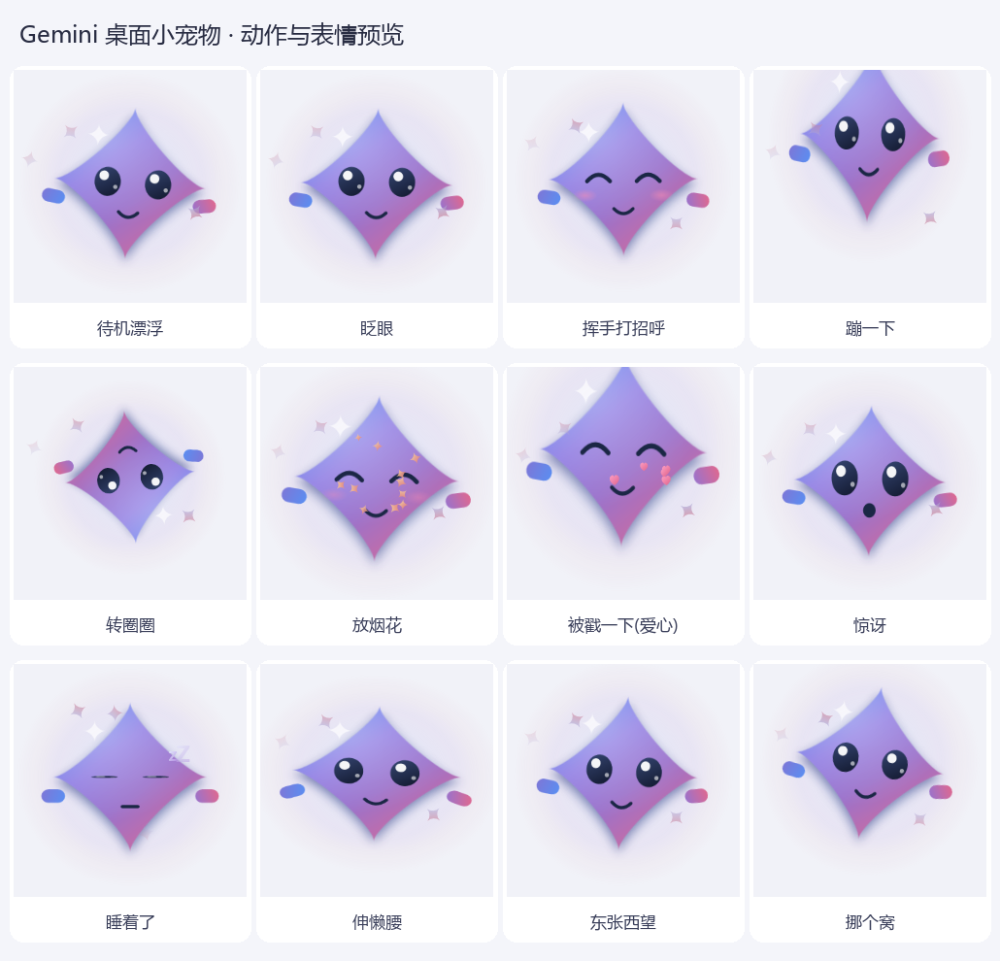
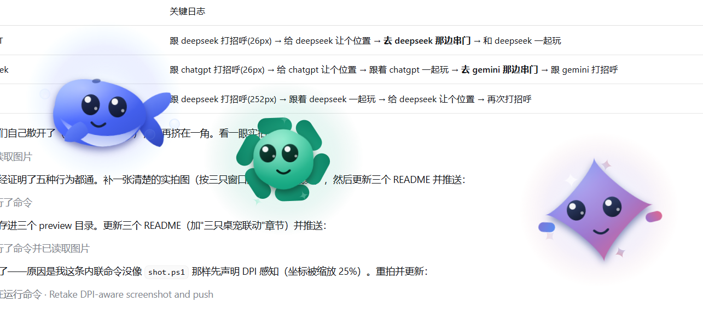

# Gemini 桌面小宠物 🐾✨

一只 Gemini 四角星小精灵,常驻在桌面角落:会漂浮、会眨眼、会自己蹦跶转圈,戳一下还会笑给你看。

**零依赖**:只用 Windows 自带的 WPF + PowerShell,不用装 Python / Node / 任何运行库。



---

## 快速开始

| 方式 | 操作 |
| --- | --- |
| 推荐 | 双击 **`启动宠物.vbs`**(无黑框,启动后直接出现) |
| 备用 | 双击 **`启动宠物.bat`**(若 .vbs 被杀软/策略拦截) |
| 命令行 | `powershell -NoProfile -ExecutionPolicy Bypass -File GeminiPet.ps1` |
| 退出 | 右键点小宠物 → **❌ 退出**(或任务管理器结束该 powershell 进程) |

启动后它会出现在**屏幕右下角**。重复启动不会开第二只(加了单实例锁;想开多只加 `-AllowMultiple`)。

---

## 怎么和它玩

| 操作 | 效果 |
| --- | --- |
| **左键点一下** | 戳它 → 随机反应:蹦跳 / 转圈 / 爱心 / 烟花,并露出笑脸和腮红 |
| **按住左键拖动** | 把它拖到桌面上任何位置(1:1 跟手,已按 DPI 缩放换算) |
| **右键** | 菜单:打招呼 · 摸摸头 · 放烟花 · 去睡觉 · 大小(小/中/大) · 换个位置 · 退出 |
| 放着不管 | 每隔几秒随机做小动作;**75 秒**没人理它会睡着(冒 Z),戳一下叫醒 |

待机时它会一直轻轻上下漂浮、左右摇摆、呼吸式缩放,并不时眨眼;旁边还有三颗环绕的小星星在转。

---

## 命令行参数

```powershell
# 加大体型(0.7 / 1.0 / 1.4 都可以)
powershell -NoProfile -ExecutionPolicy Bypass -File GeminiPet.ps1 -Size 1.4

# 重新渲染 12 张动作预览图到 preview\ 目录(也可直接双击 预览外观.bat)
powershell -NoProfile -ExecutionPolicy Bypass -File GeminiPet.ps1 -Preview .\preview

# 渲染带透明通道的预览图(用来做图标)
powershell -NoProfile -ExecutionPolicy Bypass -File GeminiPet.ps1 -Preview .\preview -PreviewAlpha

# 自检:跑 20 秒,自动把所有动作演一遍,检查有没有报错
powershell -NoProfile -ExecutionPolicy Bypass -File GeminiPet.ps1 -SelfTest 20

# 允许开多只 / 允许点击时抢焦点(默认不抢)
powershell ... -File GeminiPet.ps1 -AllowMultiple
powershell ... -File GeminiPet.ps1 -ActivateOnClick
```

---

## 让它开机自动出现

1. `Win + R` → 输入 `shell:startup` → 回车(打开"启动"文件夹)
2. 把 `启动宠物.vbs` 的**快捷方式**拖进去(右键 → 新建快捷方式也可)
3. 想让它更好看:右键快捷方式 → 属性 → 更改图标 → 选本目录的 `gemini_pet.ico`

---

## 三只桌宠联动

三只桌宠(Gemini ✨ / DeepSeek 🐋 / ChatGPT ✦)现在会互相"看见"对方:它们通过一块命名共享内存 `DesktopPets.Interop.v1` 交换自己的窗口位置与状态,**不需要任何后台服务**,谁在跑就跟谁联动。

| 联动行为 | 表现 |
| --- | --- |
| 👋 见面打招呼 | 靠近到约一个身位时,两只都会转头看过去、露出笑脸腮红并冒爱心(对方睡着了还会把它叫醒) |
| 👀 对视 | 待在一起时眼睛持续朝对方的方向偏,身体也会轻微侧倾 |
| 🎉 一起玩 | 挨着时每隔一会儿一起做动作(星星挥手转圈 / 鲸鱼翻滚冒泡 / 小花转圈撒星),一边发起、另一只几秒内跟上 |
| 🚶 串门 | 离得远时偶尔主动挪到另一只旁边待着,到了再打个招呼 |
| ↔️ 主动让位 | 挤成一坨时会自己让开一点,三只不会再叠在同一个角落 |
| 💬 说话气泡 | 打招呼 / 一起玩 / 串门 / 被戳 / 一个人发呆时都会冒一句台词,每只宠物有自己的口头禅(在 `Lines` 里改) |

另外它们有**边界保护**:联动移动或手动拖动导致宠物中心跑出屏幕时,下一帧就会自己拉回工作区(日志里记一条「边界保护」),所以不会再出现"跑出桌面找不回来"的情况。台词表在各宠物脚本注册的 `Lines` 哈希里,想换口头禅改那里即可。
只开一只时联动完全不触发;想关掉就把本目录里的 `social.ps1` 删掉(脚本检测不到会自动跳过,其余功能不受影响)。




> 实现说明:三个仓库各有一份相同的 `social.ps1`(共享内存通信 + 社交状态机),每只宠物在里面注册自己的「打招呼 / 一起玩 / 看向对方 / 移动到某处」钩子。改动这个文件请同步三个仓库。
## 技术说明

* **纯 WPF 矢量绘制**:四角星身体用贝塞尔曲线生成(Gemini 品牌渐变 `#4A88F8 → #9B72CB → #E2688C`),眼睛/腮红/小手都是矢量元素,放大不糊。
* **分层窗口**(`AllowsTransparency` + 每像素 Alpha):没有方形背景,阴影和光晕都能直接叠在桌面上。
* **不抢焦点**:窗口加了 `WS_EX_NOACTIVATE | WS_EX_TOOLWINDOW`,点它、拖它都不会把你正在打字的窗口切走(但鼠标交互、右键菜单照常可用)。
* **高 DPI**:启动时申请 Per-Monitor-V2 DPI 感知,125% / 150% 缩放下渲染依然清晰,拖动位移也按 DPI 换算。
* **性能**:30fps 定时器驱动,身体用 `BitmapCache` 缓存位图,逐帧只做合成;实测**约 5%~8% 单核 CPU、约 130MB 内存**。
* **出错不影响你**:每帧更新都包了异常捕获,异常会写进日志 `%TEMP%\GeminiPet.log`(看不到宠物、行为异常时先看它)。

---

## 文件结构

```
GeminiPet\
├─ GeminiPet.ps1        主程序(造型 + 动画 + 交互都在这一个文件里)
├─ 启动宠物.vbs         推荐启动方式(无黑框)
├─ 启动宠物.bat         备用启动方式
├─ 预览外观.bat         重新渲染 preview\ 里的预览图
├─ gemini_pet.ico       图标(可用作快捷方式图标)
├─ gemini_pet.png       图标 PNG 版
├─ preview\             12 张动作/表情预览图 + 桌面实拍 + 预览合集.png
└─ tools\
   ├─ shot.ps1          开发用:截屏 / 模拟点击拖动,验证交互是否正常
   └─ make_assets.py    开发用:由预览图生成图标与合集图
```

---

## 常见问题

* **双击没反应?** 先看 `%TEMP%\GeminiPet.log`;再改用 `启动宠物.bat`;若被杀软拦截,把该目录加入白名单。
* **已经有一只了,再点没反应?** 这是单实例保护,属正常现象(想开多只加 `-AllowMultiple`)。
* **看不到宠物?** 它可能被拖到了屏幕边缘外:删掉进程重新启动即可回到右下角默认位置。
* **想让它更安静/更省资源?** 右键 → 大小 → 小;或结束进程不看它。
* **改了代码没生效?** 先退出正在运行的那只,再重新启动。
